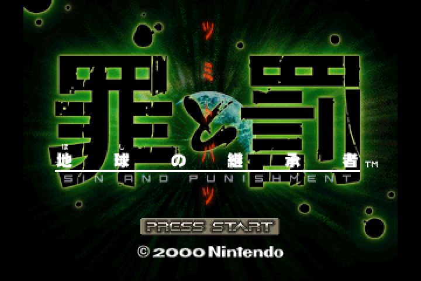
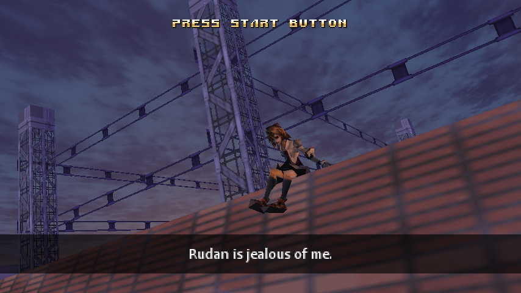
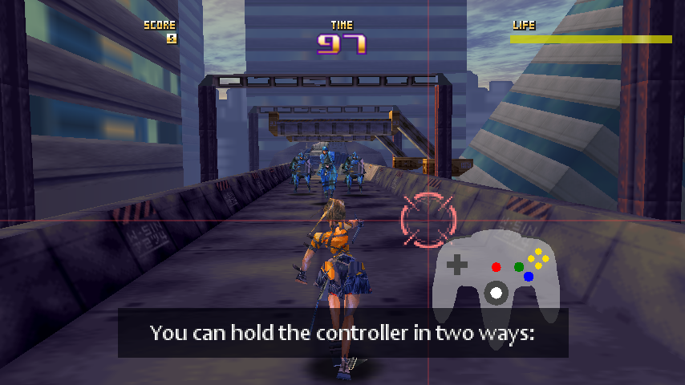
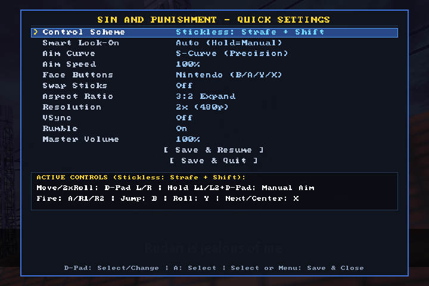
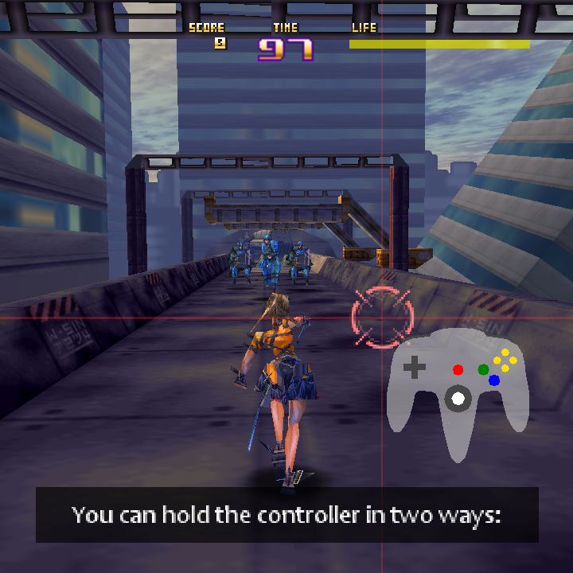
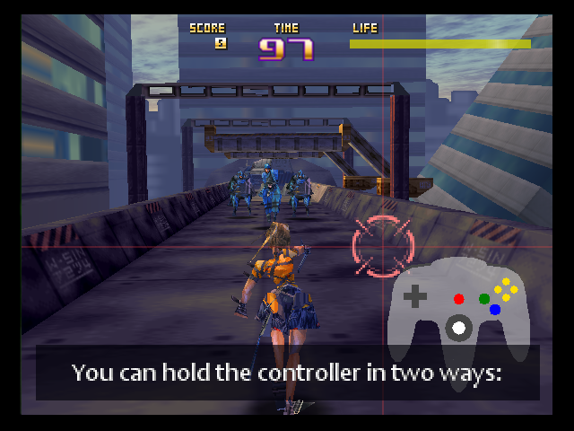
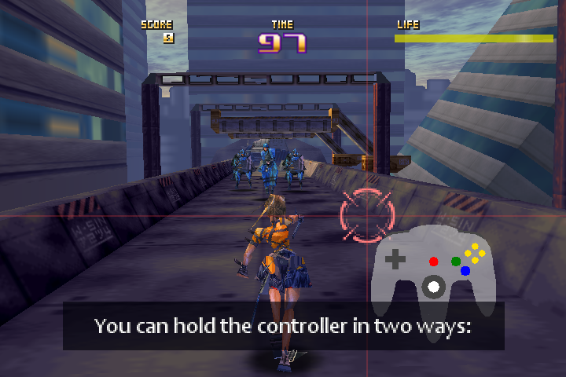

# Sin and Punishment Recompiled (PortMaster OpenGL ES 3.0)

A static C/C++ recompilation of **Sin and Punishment** (*Tsumi to Batsu: Hoshi no Keishousha*, Nintendo 64, 2000) tailored for **PortMaster** Linux handhelds (`aarch64`) and Linux desktop (`x86_64`).

Forked from [wootbeer/snprecomp](https://github.com/wootbeer/snprecomp), this port replaces the desktop Vulkan (`RT64`) renderer and launcher with a lightweight **OpenGL ES 3.0 (`F3DEX2`)** rendering backend, dedicated stickless and twin-stick handheld control schemes, and an in-game Quick Settings overlay.

Unofficial, and not affiliated with the rights holders. **No game data is included.** You must supply your own legally obtained cartridge dump to build or play.

## Screenshots

| Title Screen (`3:2` Handheld) | Opening Cutscene (`16:9` Widescreen) |
| :---: | :---: |
|  |  |
| **Stage Combat (`16:9` Widescreen)** | **In-Game Quick Settings (`3:2` Handheld)** |
|  |  |

### Aspect Ratio Comparison (`Vert+` Square & `Hor+` Widescreen vs Original)

In `Expand` mode, the 3D camera frustum adapts dynamically to any handheld panel — expanding vertically (`Vert+`) on square/tall screens (`1:1`, `5:4`) and widening horizontally (`Hor+`) on widescreen panels (`3:2`, `16:9`, `16:10`) — while scaling aiming reticle reach and anchoring 2D HUD elements (`SCORE`, `TIME`, `LIFE`, subtitles) cleanly to the screen edges without stretching:

| `1:1` Square Expand (`720x720`) | `4:3` Original (`640x480`) | `3:2` Handheld Expand (`720x480`) | `16:9` Widescreen Expand (`854x480`) |
| :---: | :---: | :---: | :---: |
|  |  |  |  |

## Highlights

- **Static MIPS + RSP Recompilation**: Translates the original Nintendo 64 game code, dynamic stage overlays, and `n_aspMain` audio microcode ahead-of-time into native `aarch64` / `x86_64` code via [N64Recomp](https://github.com/N64Recomp/N64Recomp) and [N64ModernRuntime](https://github.com/N64Recomp/N64ModernRuntime).
- **Custom OpenGL ES 3.0 `F3DEX2` Renderer**: Built for embedded handheld GPUs with no Vulkan requirement, running full-speed on **Allwinner H700 / Mali-G31 MP2** (Anbernic RG35XX / RG34XX / RGSP / RG CubeXX family), **PowerVR GE8300** (TrimUI Brick / Smart Pro), **RK3566 / Mali-G52** (Powkiddy RGB30), and **Adreno** (`min_glibc = 2.30`).
- **Native `Vert+` & `Hor+` Multi-Aspect Support**: Full `Expand` support for `1:1` square panels (`720x720`), `3:2` (`720x480`), `16:9`, and `16:10` alongside `4:3 Original`, dynamically adjusting 3D frustum culling, vertical/horizontal reticle reach, cutscene letterbox bars, and edge-anchored gameplay HUD elements.
- **Context-Aware Handheld Controls**:
  - Automatically detects analog stick count on first boot (`Stickless: Strafe + Shift` on stickless/1-stick devices, `Twin Stick` on 2-stick handhelds).
  - Automatically switches to standard D-Pad / Left Stick + `A` (Confirm) / `B` (Back) navigation across front-end menus, file select, name entry, cutscenes, and in-stage pause menus.
  - Includes **Smart Lock-On**, smooth S-curve digital reticle ramping, 1-button dodge rolling, target cycling, and quick crosshair re-centering.
- **In-Game Quick Settings Overlay (`Select` / `Menu`)**: Live configuration of control schemes (`Strafe + Shift`, `Bumper Strafe`, `Face Strafe`, `D-Pad Aim`, `D-Pad Strafe`, `Twin Stick`), face-button layout (`Nintendo` vs `Positional`), aspect ratio (`Expand` vs `Original 4:3`), resolution scale (`1x 240p` / `2x 480p`), VSync, rumble, volume, and persisted saves in `snprecomp.toml`.
- **RetroAchievements (Softcore Mode & Offline Cache)**: Built-in achievement tracking powered by `rcheevos`. Automatically imports credentials from NextUI (`minuisettings.txt`) and RetroArch (`retroarch.cfg`) or `snprecomp.toml`. Full offline support caches game sets and badge art locally, queues achievements earned while offline (`pending_unlocks.tsv`) with RTC-safe timestamping, and provides automatic and manual sync (`Sync Achievements` button) in Quick Settings.

## Supported ROM Files

Copy your own Nintendo 64 cartridge dump (`.z64`, `.n64`, or `.v64`) into `ports/sinandpunishment/roms/`. Both the original Japanese release and English fan translations are supported (with separate per-region `.eep` save files):

| ROM | SHA-1 |
|---|---|
| `Tsumi to Batsu - Hoshi no Keishousha (Japan)` | `581297b9d5c3a4c33169ae0aae218c742cd9cbcf` |
| `Sin and Punishment - Successor of the Earth (U)` (English translation) | `5945ff3935d9d9531bbb5cfcabed7c198e2b2f41` |
| `Sin and Punishment - Successor of the Earth, English v1.0 [Zoinkity]` | `e3906c919236dac6eba020b4b8c1df91fd725c5d` |

## Installing on PortMaster

1. Build `dist/sinandpunishment.zip` via `make package` (or download from PortMaster / Releases).
2. Extract `sinandpunishment.zip` into your SD card's `ports/` directory (creating `ports/Sin and Punishment.sh` and `ports/sinandpunishment/`).
3. Copy your legally obtained `.z64`, `.n64`, or `.v64` ROM into `ports/sinandpunishment/roms/`.
4. Launch **Sin and Punishment** from your device's Ports menu.

## Controls

| Button | Stickless (`Strafe + Shift` Default) | Twin Stick (`2` Analog Sticks) | Menus & Pause |
|---|---|---|---|
| **D-Pad** | Strafe L/R (`2x` tap: Roll) | Strafe L/R | Move Cursor / Navigate |
| **Hold `L1`/`L2` + D-Pad** | Manual Reticle Aim | - | - |
| **Left Analog** | Aim Assist | Strafe L/R | Move Cursor / Navigate |
| **Right Analog** | - | Reticle Aim | - |
| **A (East)** | Fire / Sword Slash | Lock-On | Confirm |
| **B (South)** | Jump / Double Jump | Melee / Cancel | Back / Cancel |
| **Y (West)** | Dodge Roll | L Button | - |
| **X (North)** | Next Target (`L1/L2 + X`: Recenter) | Dodge Roll | - |
| **L1 / L2** | Aim Shift (Manual Aim while held) | Jump / Double Jump | - |
| **R1 / R2** | Fire / Sword Slash | Fire / Sword Slash | - |
| **Start** | Pause | Pause | Start / Unpause |
| **Select / Menu** | Quick Settings Overlay | Quick Settings Overlay | Quick Settings Overlay |
| **Select + Start** | Save Config & Exit | Save Config & Exit | Save Config & Exit |

## Building from Source

The root `Makefile` wraps cross-compilation (`aarch64` Ubuntu 20.04 container toolchain for `glibc >= 2.30` compatibility), native `x86_64` host builds, GLES 3.0 renderer unit tests, packaging, and ADB device deployment:

```bash
# Build aarch64 PortMaster binary and distribution zip (dist/sinandpunishment.zip)
make build

# Build native x86_64 Linux GLES3 binary (build-host/SnPRecompiled) and run renderer tests
make host test

# Deploy over ADB to a connected handheld (preserves ROMs and saves on SD card)
make push

# Inspect device runtime log over ADB
make logs
```

For full manual CMake and `N64Recomp` code-generation steps from a Japanese ROM, see [`portmaster/README.md`](portmaster/README.md).

## Credits

- [**wootbeer/snprecomp**](https://github.com/wootbeer/snprecomp) - Original Sin and Punishment static recompilation, widescreen/HUD patches, and `snp` runtime hooks
- [**N64Recomp & N64ModernRuntime**](https://github.com/N64Recomp) by Mr-Wiseguy and contributors - Static N64/RSP recompilers and modern runtime
- **Zoinkity** - English fan translation patch
- [**Mouse Injector**](https://github.com/garungorp/MouseInjectorDolphinDuck) by Carnivorous - Reticle memory documentation
- [**spimdisasm & rabbitizer**](https://github.com/Decompollaborate) and [**n64sym**](https://github.com/shygoo/n64sym) - MIPS disassembly and SDK symbol analysis

## License

GPL-3.0 - see [COPYING](COPYING) and [`portmaster/sinandpunishment/licenses/`](portmaster/sinandpunishment/licenses/). No Nintendo 64 ROM or copyrighted game assets are included in this repository.
